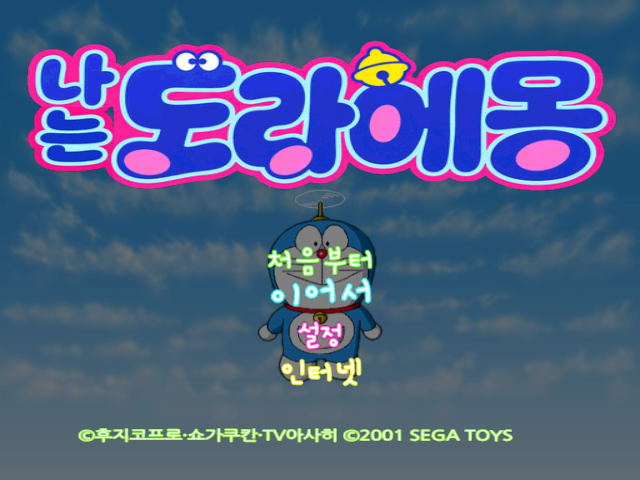
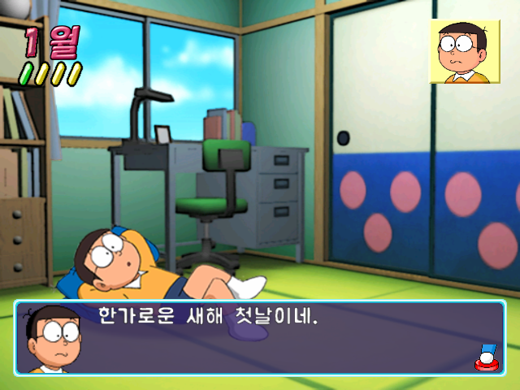
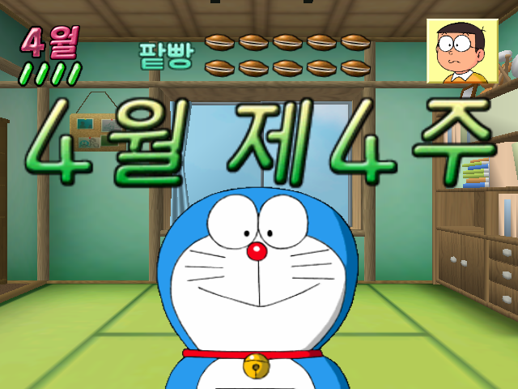
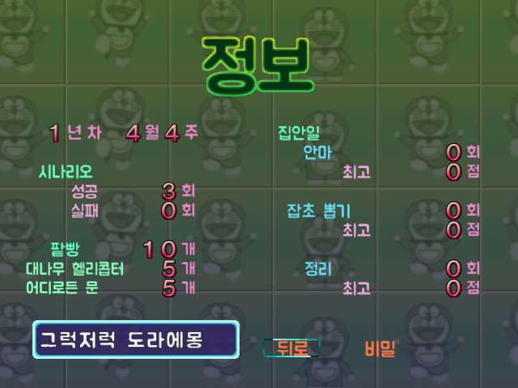
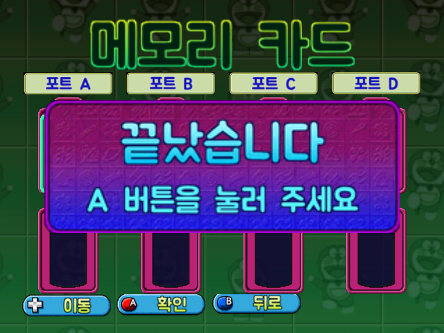
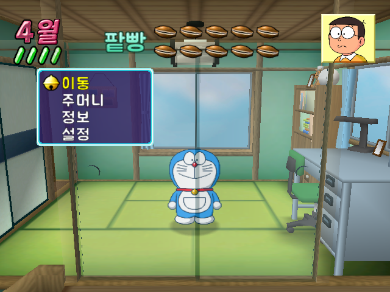
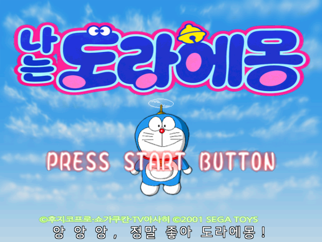
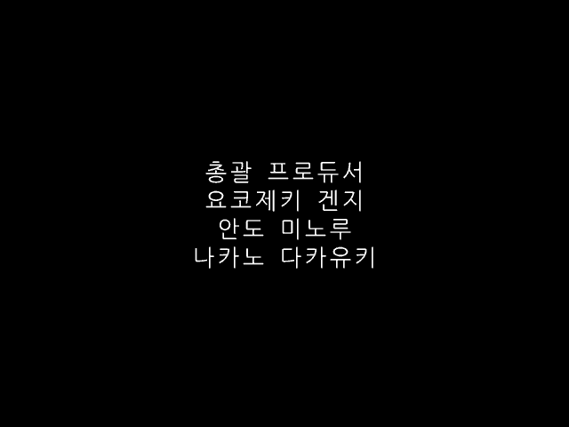
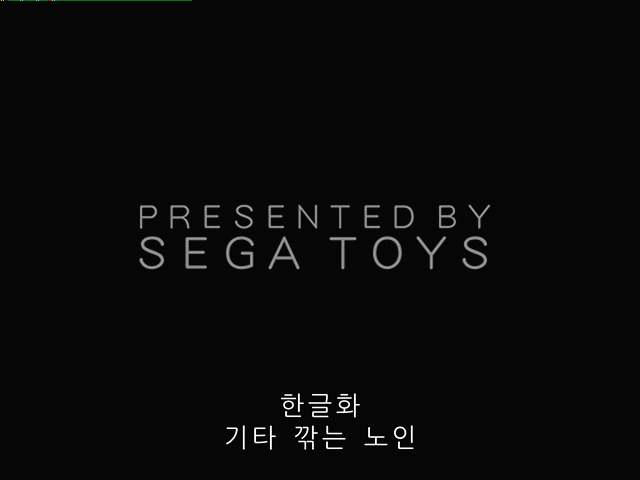

# 나는 도라에몽 한국어 패치 v0.8

드림캐스트 일본판 **Boku Doraemon / ぼくドラえもん**의 한국어 패치입니다.

**한글화: 기타 깎는 노인**

**[v0.8 EXE 패처 다운로드](https://github.com/OldManCraveGuitars-bit/DC-Boku-Doraemon-Kr/releases/download/v0.8/DC-Boku-Doraemon-Kr-v0.8-Patcher.exe)** · [릴리스와 파일 목록](https://github.com/OldManCraveGuitars-bit/DC-Boku-Doraemon-Kr/releases/tag/v0.8)

Windows 64비트용 단일 EXE에 패치 데이터와 필요한 도구를 포함했습니다. Python이나 별도 패치 프로그램을 설치할 필요가 없습니다. 원본 게임 CHD는 직접 준비해야 합니다.

## 적용 방법

1. 위의 **`DC-Boku-Doraemon-Kr-v0.8-Patcher.exe`**를 받습니다. GitHub의 `Source code` 압축 파일은 실행용 패처가 아닙니다.
2. EXE를 실행하고 **원본 CHD**에서 일본판 원본을 선택합니다.
3. **출력 CHD**에 새 파일 이름과 위치를 지정합니다. 출력 드라이브에 **3GB 이상**의 여유 공간이 필요합니다.
4. **한국어 패치 적용**을 누르고 CHD 생성과 해시 검사가 끝날 때까지 기다립니다.
5. 완성된 **`Boku Doraemon Korean-v0.8.chd`**를 에뮬레이터에서 실행합니다.

패처는 원본·패치 데이터·추출 트랙·완성 CHD를 검사합니다. 원본이나 이미 있는 출력 파일은 덮어쓰지 않습니다. 패치 중에 만든 임시 트랙은 작업 종료 시 정리합니다.

게임 데이터는 완성된 CHD 한 파일에 들어갑니다. 실행할 에뮬레이터와 필요한 BIOS, 저장용 VMU는 별도입니다. RetroArch에서는 **Flycast 코어**로 실행하세요. 기존 저장 데이터는 백업하고, 다른 빌드에서 만든 강제 저장 상태 대신 게임 자체의 불러오기를 사용하세요.

## 대상 원본

파일 이름은 달라도 되지만 **크기와 SHA-256은 아래와 같아야 합니다.** 재압축한 CHD나 이미 수정된 이미지는 대상이 아닙니다.

| 구분 | 파일 크기 | SHA-256 |
| --- | ---: | --- |
| 일본판 원본 CHD | 282,512,915 바이트 | `9ef09d65231aa437fa3d47b421c426d1cfde446d7e1d2edcdae6975d41b2a019` |
| v0.8 완성 CHD | 281,772,476 바이트 | `8544f155b0cbc4c11d97102ce73baed059589fbcb3e29b8e736d002d48e8011d` |

Windows PowerShell에서 원본을 확인하는 방법:

```powershell
Get-FileHash -Algorithm SHA256 -LiteralPath 'Boku Doraemon (Japan).chd'
```

배포 파일의 크기와 해시는 릴리스의 `SHA256SUMS.txt`에서 확인할 수 있습니다. 원본 CHD, 완성 CHD, BIOS와 개인 저장 데이터는 배포하지 않습니다.

## 작업 내용

| 항목 | v0.8에 반영한 내용 |
| --- | --- |
| 타이틀·메뉴 | 제목을 **나는 도라에몽**으로 반영. 원본의 색감과 외곽선, 메뉴 배치를 참고해 한글 이미지 제작 |
| 대사·시스템 문구 | 추출한 텍스트 **19,040개 항목**의 한국어 삽입, 반각 띄어쓰기, 한글 글리프와 폭 처리 |
| 이미지 | **117개 PVR 텍스처** 수정. 글씨를 지운 배경과 한글 글씨를 분리해 제작 |
| 달력·정보·저장 | `월`, `4월 제1주` 형식, 성공·실패 열, 수량 단위, 이동·확인·뒤로, 저장 안내 문구의 위치와 크기 조정 |
| 용어 | **팥빵** 표기 통일, 간판·일기·도구와 소품의 이미지 글씨 작업 |
| 노래 자막 | 주제가 8개·퉁퉁이 노래 6개, 총 **14개 자막 구간**. 나눔스퀘어라운드 Bold로 가독성 조정 |
| 엔딩 자막 | 두 엔딩에 각각 22개, 총 **44개 자막 구간**. 엔딩별 제작진 카드 20개 대응, 나눔고딕 사용 |
| 한글화 크레딧 | 엔딩에 **한글화 / 기타 깎는 노인** 추가 |

자막은 **게임 내부 SH-4 코드가 출력**합니다. 외부 오버레이를 켤 필요가 없습니다. 원본 영상과 오디오에 자막을 합성하거나 재인코딩하지 않았습니다.

웹/DreamPassport 기능은 작업 범위에서 제외했습니다. 원본 유지로 결정한 일부 소품 이미지와 로딩 캔도 그대로입니다. 자세한 제작 내용은 [작업 기록](docs/WORKLOG.md), 실행 확인 범위는 [검증 기록](docs/VERIFICATION.md)에 정리했습니다.

## 스크린샷

게임을 실행해 캡처한 화면입니다. 엔딩 두 장은 원본 엔딩 로더를 호출하는 검증용 진입으로 확인했습니다. 전체 캠페인을 끝까지 플레이했다는 뜻은 아닙니다.

| 일반 대사 | 달력 전환 |
| --- | --- |
|  |  |

| 정보와 팥빵 수량 | 메모리 카드와 조작 안내 |
| --- | --- |
|  |  |

| 게임 중 메뉴 | 주제가 자막 |
| --- | --- |
|  |  |

| 엔딩 자막 | 한글화 크레딧 |
| --- | --- |
|  |  |

## 확인 범위

Windows의 **Flycast**와 **RetroArch 1.22.2 + Flycast 코어**에서 실행을 확인했습니다. RetroArch에서는 새 부팅, 한글 타이틀·메뉴·노래 자막, 새 게임 도입부 대사, 게임 자체 VMU 불러오기, 4월 제4주 전환, 정보창과 일반 메뉴를 확인했습니다.

19,040개 텍스트 항목의 현재 디스크 삽입 상태를 대조했고, 기존 번역 검수에서 수정한 59건도 다시 확인했습니다. 이번 배포 시점에 전체 문장을 새로 재번역하거나 전 구간을 다시 청취한 것은 아닙니다.

**실물 드림캐스트, Android 등 다른 환경, 모든 분기와 전체 음성의 청취 검수는 아직 확인하지 못했습니다.** 조사해도 확정되지 않은 제작진 인명 등은 기존 한국어 표기를 유지했습니다. v0.8의 확인 범위는 위 기록을 기준으로 봐 주세요.

## 소스와 고지

[패처 소스](patcher/patcher.py) · [대상·트랙 해시](patcher/manifest.json) · [빌드 방법](docs/BUILD.md) · [변경 기록](CHANGELOG.md) · [외부 도구·폰트 고지](THIRD_PARTY_NOTICES.md)

패처 소스의 라이선스는 [MIT](LICENSE)입니다. 외부 도구·폰트와 원작 게임의 권리는 각각의 권리자에게 있습니다.
